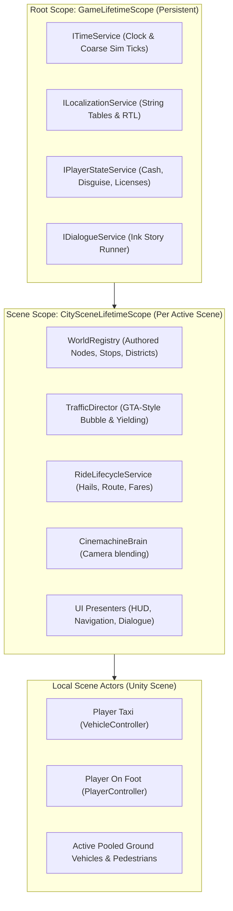
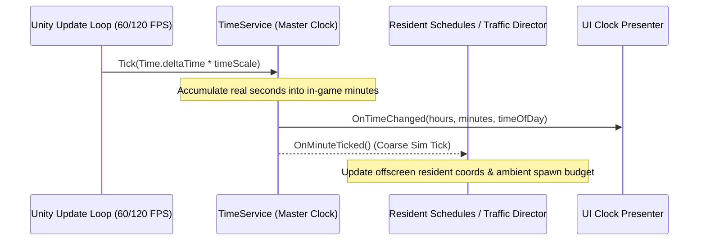
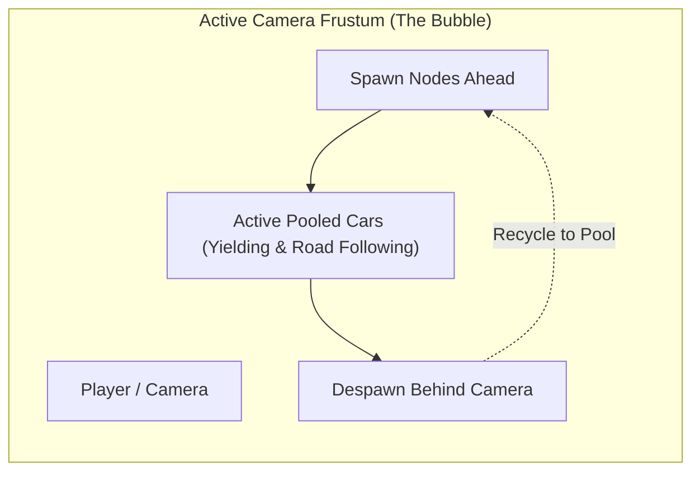
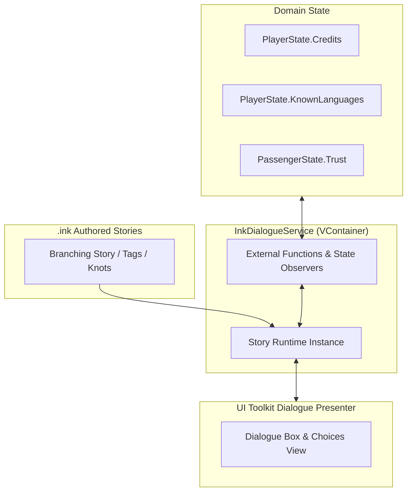
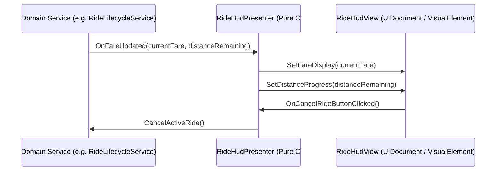

# Systems Architecture & Engineering Blueprint

**Repository:** MohamedXIV/OutsiderDriver  
**Engine:** Unity 6 (`6000.6.0f1`), Universal Render Pipeline (URP 2D)  
**Authoritative Date:** 2026-10-23  
**Companions:** [Game Design](GAME_DESIGN.md), [Decision Register](DECISIONS_AND_OPEN_QUESTIONS.md), [Engineering Principles](ENGINEERING_PRINCIPLES.md)

---

> **Hard design constraints confirmed 2026-10-24:** The game remains a **genuine Unity 2D Isometric game**, NOT a 3D world with an isometric camera. Content should be **data-driven wherever practical**, with stable IDs such as `district_01` independent of proposed names, localized labels, lore, descriptions and authored coordinates/bounds. This is a requirement for editable authored content, **not** a mandate to implement a general database, content-management platform or procedural city system. See [World & Content Data Contract](WORLD_CONTENT_DATA_CONTRACT.md). This technical blueprint must not override newer owner decisions or assume old technical examples are locked product choices.

## 1. Architectural North Star

Outsider Driver is a **freeform, cozy-but-socially-dangerous alien retro-futurist taxi and life sandbox**. Its technical architecture is built around three core tenets:
1. **Separation of Concerns without Framework Theater:** Domain logic (pure C# DTOs and interfaces), scene presentation (Unity MonoBehaviours and SpriteRenderers), and UI (UI Toolkit) remain strictly decoupled.
2. **Data-Driven Authoring:** Static definitions (passengers, vehicles, districts, language chips) live in `ScriptableObject` assets. Runtime mutable states (cash, trust, trip progress) live in serializable C# classes/records.
3. **Perceived Life over Brute-Force Simulation:** The city feels alive through bounded, budgeted systems (GTA-style ambient pooling around the camera, Skyrim-style coarse-schedule virtualization for off-screen residents, and The Sims-style discrete simulation ticks).

---

## 2. Dependency Injection: VContainer

The project adopts **[VContainer](https://github.com/hadashiA/VContainer)** for fast, allocation-free, decoupled dependency injection.

### A. Lifetime Scope Hierarchy
* **`GameLifetimeScope` (`DontDestroyOnLoad`):**
  * Contains system-level, cross-scene services:
    * `ITimeService`: World clock, calendar, pause handling, discrete simulation ticks.
    * `IPlayerStateService`: Player profile, inventory, cover identity integrity, credits.
    * `IDialogueService`: Ink runtime host, global variable observers, and function bindings.
    * `ILocalizationService`: Language switching and RTL text handling.
* **`CitySceneLifetimeScope` (Attached to Gameplay Scenes):**
  * Registers scene-bound directors and registries:
    * `RoadNetwork` / `WorldRegistry`: Graph querying and landmark locations.
    * `TrafficDirector`: Ambient vehicle/pedestrian spawner and pool manager.
    * `RideLifecycleService`: Active passenger ride state machine.
    * UI Presenters injecting both domain models and scene `UIDocument` views.

### B. Anti-Pattern Guardrail: No Monolithic God GameManager
* No single static `GameManager.Instance` is permitted to accumulate unrelated responsibilities.
* Classes declare dependencies explicitly via constructors (`[Inject] public VehicleController(ITimeService timeService) ...`).

---

## 3. Simulation Kernel & Time System (The Coarse Tick)

Following best practices from **The Sims** and **Skyrim**, the simulation is decoupled from the rendering frame rate:

* **Continuous Real-Time Clock:** In-game time advances in real time (e.g. 1 real second = 1 in-game minute, configurable).
* **Discrete Simulation Ticks (`OnMinuteTicked`):**
  * Relationship decay, resident schedule changes, vehicle dispatch timers, and market price fluctuations evaluate *only* on the coarse tick.
  * Frame-rate drops or high-refresh monitors do not alter simulation behavior.
* **Pause & Comfort:** Travel and conversation allow smooth pausing without freezing background rendering or UI animations.

---

## 4. Traffic & Pedestrian System (The GTA Director Pattern)

Instead of simulating physics on hundreds of vehicles across the entire city:

1. **The Moving Bubble:**
   * A `TrafficDirector` continuously queries the `RoadNetwork` within an active radius (e.g. 35 meters) around the player's taxi or character.
   * Ambient ground-contact vehicles and passersby spawn from an `ObjectPool` at road edges entering the bubble.
   * When an entity leaves the radius or passes behind the camera, it is returned to the pool immediately.
2. **Intersection Right-of-Way & Yielding:**
   * Road nodes at intersections define priority rules (e.g., main street vs. side alley, roundabouts).
   * Vehicles cast short forward 2D sensor rays; if another vehicle is occupying the intersection node with higher priority, the vehicle decelerates and yields cleanly.
   * Ambient drivers maintain zero persistent state; when recycled, their temporary data is discarded.
3. **Resident NPCs (Skyrim Radiant AI Model):**
   * Named, significant passengers and friends have lightweight schedule data (`At 14:00 be at Market Junction`).
   * Off-screen: Their world coordinates update virtually on the coarse `TimeService` tick without physics or pathfinding.
   * On-screen: When the player is in the same district, they are instantiated as rich physical actors.
4. **Pure Kinematic Movement (Physics Engine Banned for Vehicles - Decision P-024):**
   * Vehicles use deterministic kinematic movement (acceleration, deceleration, yielding, and route following) along the authored road graph.
   * `Rigidbody2D`, wheel colliders, and momentum physics are strictly banned to avoid physics deadlocks, intersection pileups, clipping, and frame drops.
5. **Native Unity 2D Isometric Pipeline & Cinemachine 3 (Decision P-025):**
   * World layout is authored using Unity's native `Grid` and `Tilemap` (`Isometric Z as Y`).
   * Visual depth is handled automatically via Unity's Project Transparency Sort Axis (`TransparencySortMode.CustomAxis` with `{x: 0, y: 1, z: -0.26}`), removing the need for custom z-sorting scripts.
   * Camera tracking is powered by Unity 6's Cinemachine 3 (`CinemachineBrain` and `CinemachineCamera`), enabling smooth framing and automatic blending between taxi navigation and on-foot walking.

---

## 5. Narrative Engine: Ink Integration

Dialogue and contextual conversation are core pillars of Outsider Driver. We use the **official Inkle Ink integration (`ink-unity-integration`)**.

* **Contextual & Reusable:** Ink files are compiled into `.json` assets within Unity.
* **Two-Way State Binding:**
  * External functions allow Ink to query game truth directly (`CanUnderstandLanguage("TradeCant")`, `GetPlayerCredits()`).
  * Story variable changes automatically emit C# events (`~ player_trust += 1` -> updates `PassengerState`).
* **Non-Blocking Travel:** Dialogue runs concurrently with semi-autonomous taxi travel; reaching a destination pauses or wraps up narrative lines gracefully without abrupt cutoff.

---

## 6. UI Architecture: UI Toolkit + Event-Driven MVP

The user interface uses **Unity 6 UI Toolkit** (`com.unity.modules.uielements`) structured under the **Model-View-Presenter (MVP)** pattern:

* **The View (`UIDocument` / VisualElement):**
  * Declarative UXML layouts and USS style sheets.
  * Zero gameplay simulation code; only exposes UI events (`OnButtonClicked`) and visual setter methods (`SetText`, `SetVisible`).
* **The Presenter:**
  * Injected via VContainer.
  * Subscribes to domain events from `TimeService`, `RideLifecycleService`, and `PlayerStateService`.
  * Forwards user actions from the View to domain services.

---

## 7. Localization: Early String Tables & RTL Support

To ensure seamless localization without retroactive refactoring:
* **Unity Localization Package (`com.unity.localization`):** Installed from Day 1.
* **No Hardcoded Strings:** All in-game text (HUD labels, dialogue prompts, passenger requests, district names) uses String Table keys.
* **Arabic & RTL Support:** Supported natively through TextMeshPro / UI Toolkit RTL shaping and bidirectional font assets.
* **Alien Glyphs & Languages:** Asset Tables allow mapping translation chips to specific fonts or obscured alien syllabaries when the driver lacks the required translator module.

---

## 8. Character Portraits & Visual Pipeline

* **Layered 2D Sprites + Unity 2D Animation:**
  * High-quality expressive portraits are authored as layered 2D assets (Base head/torso, swappable eye expressions, mouth phonemes, emotional indicators).
  * Subtle idle breathing and head-tilts are driven by Unity's native 2D Animation bones (`com.unity.2d.animation`) and Sprite Resolvers.
* **Rejected Alternatives:**
  * **Live2D Cubism:** Rejected due to restrictive free-tier limitations, recurring commercial subscription costs, and proprietary runtime bloat.
  * **Inochi2D:** Rejected due to lack of stable, officially supported Unity runtimes.
  * **Full DOTS/ECS:** Rejected as unnecessary overhead for ~20-50 visible entities.

---

## 9. Performance & Measurement Standards

In accordance with [ENGINEERING_PRINCIPLES.md](ENGINEERING_PRINCIPLES.md), all performance claims must be verified via actual measurements:
* **Target:** Stable 60–120+ FPS on target desktop platforms with zero memory allocations in the main gameplay loop.
* **Testing:** Benchmarked in standalone Player builds using Unity Profiler and memory profiler snapshots, measuring frame time, GC allocations, script time, and physics steps over 15+ minute continuous sessions.
